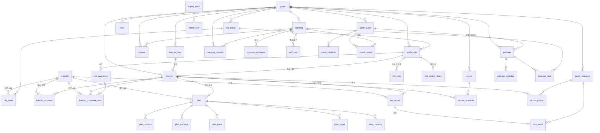

# ERD

- 근거 문서 : [요구사항명세_기능.md](../01_requirements/요구사항명세_기능.md), [요구사항명세_비기능.md](../01_requirements/요구사항명세_비기능.md) (Data-001~005, Sec-001·006), [기능명세서.md](../01_requirements/기능명세서.md)
- 테이블 목록 : [테이블_도출.md](테이블_도출.md)
- 컬럼 상세 : [테이블_정의서.md](테이블_정의서.md)
- 관련 이슈 : #6
- 현재 버전 : v0.1
- 변경 내용 : v0.1 - ERD 작성
- 대상 DB : Oracle (요구사항명세_비기능.md의 개발 환경 기준)

